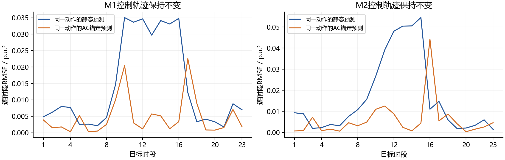

# M1与M2在信息不完备条件下的电压调控能力对比分析

报告日期：2026-10-23

## 1 研究结论与评价口径

本报告评价现有 M1 静态鲁棒优化与 M2 量测反馈单步滚动优化，在信息不完备条件下的电压调控能力、预测鲁棒性、可解释性及工程适用性。结论依据相同物理环境的既有算例，并补充不改变动作的预测误差诊断。

**直接结论：本次算例中，M1 的实际电压控制表现更好；M2 的反馈预测能力和光伏消纳表现更好。可解释性各有侧重，不能用一个总分认定某模型全面更强。**

| 评价维度 | 当前判断 | 依据或限制 |
| --- | --- | --- |
| 实际电压合格性 | M1 更好 | M1 无越限；M2 有 3 个节点时段过电压 |
| 同权重实际 AC 代价 | M1 更低 | 0.303066 对 4.699691 |
| 平均名义预测精度 | M2 更好 | 时段 1-23 的 RMSE 下降约 45.20% |
| 最坏预测误差 | M1 较小 | 最大绝对误差 0.065118 对 0.086768 p.u.² |
| 光伏消纳 | M2 更好 | 弃光 0 对 M1 的 3030.658 kWh |
| 全日计划可解释性 | M1 更直接 | 全日约束和储能跨时段关系一次展现 |
| 单步纠偏可解释性 | M2 更直接 | 量测起点、外部变化和动作增量可逐步拆解 |
| 一般信息缺失下谁更强 | 尚不能判定 | 未覆盖参数偏移、预测误差、噪声或延迟 |

### 证据分层

**算例事实**指已保存的优化与 AC 数据及可复算统计；**机制分析**指从现有方程推导的关系；**待验证判断**指尚未开展的跨场景或控制改进试验。三者在报告中分别说明，不把结构优势写成实验已经证明的结论。

评价优先看控制执行后的电压与约束，再看消纳、损耗和计算代价。预测目标较小、预测区间较窄、求解器返回最优，都不能单独证明实际电压控制更强。[E1-D2]

## 2 信息不完备的具体含义

本项目的信息不完备具有明确边界：线路 r/x 用固定盒式集合描述；负荷光伏、拓扑和反馈量测采用理想设置。它尚不是所有不确定因素同时存在的综合试验。[D1-D2]

| 信息或条件 | M1 静态模型 | M2 滚动模型 |
| --- | --- | --- |
| 网络拓扑与设备映射 | 固定且已知 | 相同，固定且已知 |
| 线路参数 | 4 条线路的 r/x 各自 ±30% | 相同固定盒集，不在线收缩 |
| 实际线路参数 | 原始 BRANCHES 数值 | 相同数值 |
| 负荷和光伏 | 全日准确时序 | 每步使用准确的当前及下一时段输入 |
| 电压反馈 | AC 只用于事后评价 | 全部非根节点 AC 平方电压直接反馈 |
| 量测及执行误差 | 未注入执行误差 | 未注入量测、执行误差或延迟 |
| 储能能量与初态 | 完整状态已知 | 相同初态，后续按自身动作递推 |
| 运行中预测时域 | 一次联合优化 24 时段 | 初始化后 23 次单步求解 |

### 真实参数位于名义中心

本次新增核对得到 max|θ真实 − θ名义| = 0。控制器仍使用非零宽度的不确定集合，但实际 AC 环境只取了集合中心一个点。因此，本结果可以评价这次受不确定集合约束的控制轨迹，不能代表真实参数遍历整个集合时的最坏控制能力。[E3]

### 外在条件相同与信息结构不同

已精确核验目标系数 C_V=100、C_CURT=1，以及设备参数、SOC、初始动作、母线复电压、负荷光伏、真实阻抗、限值和求解设置相同。双方控制均执行 AC 校验，共 24 对；原有 13 项检查全部通过。[E1-E2]

M1 获得全日计划信息，M2 在运行中获得自身 AC 量测。M2 的初始动作还取自同一次完整 M1 求解，间接继承了全日计划信息。物理公平不等于信息结构相同，也不能把本比较解释成只改变反馈这一因素的消融试验。

## 3 控制效果与预测鲁棒性

AC 统计采用完整 24 时段、32 个非根节点。预测统计采用相同目标时段 1-23，共 736 个节点时段；M2 第 0 时段是共同 M1 初始化，不计作独立预测。

| 实际 AC 指标 | M1 | M2 |
| --- | --- | --- |
| 最低 / 最高电压 p.u. | 0.933288 / 1.045019 | 0.931564 / 1.064196 |
| 电压越限节点时段 / 时段数 | 0 / 0 | 3 / 2 |
| 节点时段电压合格率 | 100.000% | 99.609% |
| 最大过电压幅度 p.u. | 0 | 0.014196 |
| 弃光电量 kWh | 3030.658 | 0.000 |
| 有功网损 kWh | 7589.832 | 8386.863 |
| 主网无功越限时段数 | 7 | 19 |
| 主网无功最大越限 kvar | 669.672 | 910.805 |
| 日末储能能量 kWh | 400.000 | 513.874 |
| 统一实际 AC 代价 | 0.303066 | 4.699691 |

| 预测指标 时段 1-23 | M1 | M2 |
| --- | --- | --- |
| 鲁棒下界最小值 / 上界最大值 p.u. | 0.934122 / 1.050000 | 0.930000 / 1.050000 |
| 电压松弛总量 / 预测越限数 | 0 / 0 | 0 / 0 |
| 预测目标累计值 | 0.303066 | 0 |
| 平均鲁棒区间宽度 p.u.² | 0.017265 | 0.007521 |
| 名义预测 RMSE p.u.² | 0.019419 | 0.010642 |
| 最大绝对预测误差 p.u.² | 0.065118 | 0.086768 |
| 自身预测包络对 AC 的覆盖率 | 35.326% | 29.484% |

J_AC 沿用 100×平方电压越限总量 + 弃光标幺值总量，不额外计入网损、无功越限或储能残值。M1 电压合格不意味着全部运行约束合格；双方实际主网无功均有超限。覆盖率是本次样本的几何落入比例，不是概率置信度。[E1]

## 4 反馈如何改善预测

为排除不同控制动作对预测误差比较的干扰，新增诊断分别固定 M1、M2 已执行的完整轨迹，在同一轨迹上计算静态预测和 AC 锚定预测。不重新优化、不改变控制、不生成新的实际潮流。[E3]

记 v 为平方电压，L_t=1+H_tθ名义 为绝对线性预测，e_t=v_t^AC−L_t 为该轨迹上的模型残差。当前 M2 使用的增量模型满足：

`v̂_(t+1)^M2 = v_t^AC + L_(t+1) − L_t`

`v_(t+1)^AC − v̂_(t+1)^M2 = e_(t+1) − e_t`

因此，实测起点吸收上一时段已经存在的偏差。若残差变化缓慢，预测误差可能明显下降；若运行点变化使残差突变，增量预测仍可能出现大误差。这是当前方程的代数关系，不是对未来闭环性能的保证。

| 固定的控制轨迹 | 静态 RMSE | AC 锚定 RMSE | 下降比例 |
| --- | --- | --- | --- |
| M1 已执行动作 | 0.01941938 | 0.00751641 | 61.29% |
| M2 已执行动作 | 0.02437538 | 0.01064202 | 56.34% |

单位为 p.u.²，窗口为时段 1-23。误差差分恒等式最大残差小于 4×10⁻¹⁶；保存的 M2 名义预测也与重构值一致。M1 行中的锚定预测仅为离线诊断，不能将其当作已运行的新控制器。

**可支持的结论：**本次两条轨迹上，实测起点确实降低了平均预测误差。**不可据此推出：**反馈一定改善电压合格率，或信息越缺失 M2 越有优势。

## 5 为什么预测更准却出现过电压

M2 的全部电压越限集中在以下三个节点时段。它们在优化器自己的鲁棒电压包络内均满足限值，但 AC 执行结果超过上限 1.05 p.u.。[E1-E3]

| 时段 | 母线 | 名义预测 p.u. | 鲁棒上界 p.u. | AC 电压 p.u. |
| --- | --- | --- | --- | --- |
| 14 | 33 | 1.049845 | 1.050000 | 1.050614 |
| 16 | 17 | 1.015781 | 1.043343 | 1.057447 |
| 16 | 18 | 1.022617 | 1.050000 | 1.064196 |

### 第 16 时段的残差突变

以母线 18 为例，绝对线性模型残差由时段 15 的 −0.102157 变为时段 16 的 −0.015389 p.u.²，其差为 +0.086768 p.u.²，正好对应 M2 的名义预测误差。上一时段较大的负残差被作为偏移带入下一步，下一时段该偏差大幅减小，产生明显低估。

该节点名义预测仅 1.022617 p.u.，鲁棒上界 1.05 p.u.，实际却达 1.064196 p.u.。这条数值链支持“变化中的线性化残差未被鲁棒集合覆盖”的解释；仅凭当前轨迹，不能进一步把越限归因于某一台设备的单独作用。

### 鲁棒集合覆盖的是参数项

令 h_(i,t) 为绝对线性模型在节点 i 的参数系数向量，盒集半径为 ρ。沿各自轨迹，M1 的区间宽度为 2ρᵀ|h_(i,t)|，M2 为 2ρᵀ|h_(i,t+1)−h_(i,t)|。后者平均较窄并不表示参数知识增加；集合从未更新。它也不必然更窄：本次最大宽度 M2 为 0.113508，M1 为 0.110014 p.u.²。

参数盒集没有显式包含 e_(t+1)−e_t，也没有量测噪声界。参数属于集合时，鲁棒约束成立的对象仍是线性预测；非线性 AC 模型残差并未被消除。第 14 时段母线 33 的预测上界已贴限，较小的正向残差变化也足以造成轻微过电压。

### 平均指标与尾部指标必须同时看

M2 的平均误差下降约 45.20%，但最大绝对误差比 M1 高约 33.25%，包络覆盖率也更低。预测更集中、弃光更少，可能伴随更小的安全余量；本场景的结果支持这一权衡，但尚不能证明普遍的因果关系。

## 6 两种模型的可解释性

**两者都是显式物理模型和优化约束构成的模型，均具有较强的结构透明性。**“谁更可解释”应区分全日计划、单步纠偏、鲁棒保证和设备贡献，而不宜只给一个主观总分。

| 解释对象 | M1 的特点 | M2 的特点 |
| --- | --- | --- |
| 物理因果链 | 注入、支路、路径与绝对电压关系清楚 | 实测电压、外部变化和动作增量关系清楚 |
| 全日储能安排 | 能量耦合及各时段取舍可整体检查 | 只看下一步，长期安排较难解释 |
| 单步纠偏原因 | 计划生成后不因 AC 偏差改动 | 能逐步追溯量测起点如何改变决策 |
| 鲁棒可行证据 | 盒集极值及原始约束可独立验算 | 盒集支持函数、对偶约束均可独立验算 |
| 结果复现 | 给定输入一次求解，审计链较短 | 需要保存历次量测、动作、能量和求解状态 |
| 唯一设备贡献 | 多解与耦合限制唯一归因 | 同样受多解、耦合和历史状态影响 |

### 哪一项更强

若面向计划审核者，需要解释“为什么全天这样安排储能与弃光”，M1 更直接。若面向在线运行人员，需要解释“为什么看到本时段电压后下一步调整”，M2 更直接。两者的数学鲁棒约束都可以核验，没有证据认为其中一者天然更难解释。

### 解释不能越过证据边界

M2 保存的 λ⁺、λ⁻是把参数最坏情形约束对偶化后引入的优化变量，用于形成可行证书。它们不能直接当作 MILP 电压约束的经济影子价格，也不能据此给设备重要性排序。离散电容档位、充放电模式和多重最优解进一步限制了常规边际解释。

M1、M2 均没有动作平滑或额外择优项；M2 预测目标为零时仍可能存在多组同目标动作。因此，“该设备这样动作”不必然代表唯一必需动作，也不能仅按一次解的动作幅度认定设备贡献。当前报告给出的是可追溯解释，不声称完成唯一因果归因。

若后续需要设备贡献分析，应固定同一实际状态，逐台限制设备后重新求解并做 AC 复核，比较电压、弃光与可行性变化；这属于额外的受控试验，本次未执行。

## 7 工程代价与适用条件

| 计算或动作指标 | M1 | M2 |
| --- | --- | --- |
| 优化次数 | 1 次全日求解 | 23 次单步 加共同初始化 |
| 求解器 Runtime | 全日 0.165 s | 单步平均 0.00935 s |
| 运行中求解 Runtime 合计 | 0.165 s | 0.215 s |
| 计入初始化的求解 Runtime | 0.165 s | 0.380 s |
| 组装及求解合计 | 0.193 s | 滚动 2.894 s 初始化另计 |
| 电容器档位变化事件数 | 26 | 15 |
| 电容器档位总移动量 | 70 | 48 |
| SVG 无功变化总量 kvar | 8444.987 | 20829.625 |
| 储能有功变化总量 kW | 7998.085 | 10095.315 |

动作统计对时段 0-23 相邻动作取绝对差并求和。一个电容器在一个转换中改变档位计一次事件；跨多档计入档位总移动量。这些是动作幅度代理量，不能直接解释为硬件寿命、磨损成本或能耗。[E3]

### 计算能力与动作平滑性

M2 单步求解很快，支持本机本算例的逐时段执行；但重复建模、量测通信和实际控制执行的开销需要另算。单次全日求解与单次单步求解不是同等任务，不能据均值宣称 M2 总计算更省。当前只有一次运行记录，也不是时延统计或实时性能保证。

M2 的电容器动作较少，但 SVG 与储能动作变化总量更大，不能笼统称它动作更平滑。由于原模型未加入爬坡、开关次数或动作成本，差异只能作为本轨迹特征。

### 实际部署依赖

M1 更依赖全日预测质量，但执行预定计划时不需要每步在线优化。M2 更依赖可靠的节点电压、实际动作和 SOC 反馈；它仍需要固定拓扑、设备映射及下一时段外部注入，不能称为无模型方法。当前固定参数集合也意味着它没有在线辨识能力。

小时级稳态 AC 收敛并非动态电压稳定性证明。电压软约束有助于模型可求解，但不能保证设备约束和主网约束下的递归可行性；两者均未实现求解失败、通信失效时的控制回退逻辑。

## 8 能力边界与下一步验证

若研究问题是“信息越不完备，谁的电压调控能力更强”，需要把信息缺失类型与程度作为受控变量。当前证据仅支持固定拓扑、准确外部时序、理想反馈、单个真实阻抗场景下的比较。

| 建议试验 尚未执行 | 成对一致条件 | 要回答的问题 |
| --- | --- | --- |
| 真实参数偏离名义值 | 同一固定真实 r/x、同一盒集、同一初态 | 中心结论能否推广到边界和内部样本 |
| 负荷光伏预测误差 | 同一实际曲线和误差生成过程；明确各时刻可用信息 | M2 反馈是否改善错误预测下的电压 |
| 噪声 延迟 缺测 | 同一真实环境；明确反馈处理及估计器 | M2 优势何时被量测误差抵消 |
| 突变与运行点切换 | 同一扰动时刻和幅值 | 残差突变时的最大越限及恢复时间 |
| 同预测时域消融 | 固定时域与设备条件，仅改变反馈机制 | 区分反馈收益与全日规划收益 |
| 重复场景与多解敏感性 | 同一场景配对、固定种子集及统一统计 | 结论对场景与最优解选择是否稳定 |

参数角点可用于压力测试，但非线性 AC 对参数的最坏情形不一定出现在角点；有限随机样本也不能证明全局鲁棒性。每个实际参数场景保持全天固定，避免把参数误差与参数时变混为一谈。

### 进一步试验的公平性要求

每对试验共享外在真实条件、设备初态、目标权重和评价程序，按同一时段配对 AC 结果。公共预热动作须记录并对双方同时生效。新增信息误差、终端约束或控制回退策略应单独命名，不能替换后仍称为原始 M1/M2 比较。

建议同时报告电压越限幅度与持续时间、实际主网 P/Q 约束、弃光、网损、日末储能、失败次数和计算时间。只有在足够的配对场景上，才适合进一步报告均值差、分位数和不确定区间；当前单条日轨迹不做显著性检验。

### 有条件的模型选择

就当前已验证版本，若首要要求是本算例的电压合格，应优先采用 M1 的控制结果作为基准；若研究目标是实时量测利用与减少弃光，M2 更值得继续改进。可研究残差变化包络、约束收紧或 AC 可行性修正，但这些都会改变算法，须作为改进版本重新与原基准比较。

## 9 可引用结论与证据索引

**可用于论文或研究记录的结论：**在相同网络、设备、负荷光伏、目标权重及初始状态下，M1 与 M2 均满足各自线性鲁棒模型的电压约束。统一 AC 校验表明，本算例 M1 未出现电压越限，M2 出现 3 个节点时段过电压，但实现零弃光并具有更低的平均名义预测误差。固定控制轨迹的诊断进一步表明，AC 量测起点能够减小平均预测偏差，而线性化残差的时序变化仍可能产生显著误差。由此，M2 展现了利用实时信息的机制优势，但现有证据不足以证明其在一般信息不完备条件下的实际电压调控能力全面优于 M1。

### 本地证据与复核入口

[E1] results/summary.json、m1_results.npz、m2_results.npz 及 robust_prediction_metrics.csv：全部统计、预测和实际 AC 轨迹。此前对比报告见 results/对比报告.md。

[E2] results/fairness_audit.json、initial_state_audit.json、paired_ac_audit.json、validation_details.json、test_results.txt：场景一致、共同初态、48 次 AC、模型残差和 13 项检查记录。

[E3] analysis/capability_diagnostics.json、analyze_capability.py：本次新增的同动作预测诊断、残差恒等式、越限逐点记录和动作统计。JSON 保存输入文件 SHA256；本次无新优化和 AC 求解。

[D1] 原项目“代码编写指南/M2模型实现稿.pdf”，含假设 A1-A10 与递推模型。[D2] 同目录“补充要求.md”，重点为 0.6-0.10 节的初始化、真实 AC 反馈与研究边界。冻结的实现位于 frozen_model/。

### 相关研究用于机制背景

反馈优化利用系统量测修正输入，是处理模型不精确的一种路径；但闭环安全与收敛仍需单独分析。[L1] 这与本报告把预测改善、约束满足和稳定性分开评价的做法一致。

已有实际配电网实验展示了特定反馈优化控制器对模型失配的适应能力。[L2] 其控制律、量测要求和试验对象均不同，不能把该论文的优越性或保证直接转移给本项目的单步鲁棒 MILP。

[L1] ETH Zurich Automatic Control Laboratory. Online Optimization as Feedback Controllers. [ETH 研究介绍](https://control.ee.ethz.ch/research/theory/online-optimization-as-feedback-controllers.html)

[L2] Ortmann L, Hauswirth A, Caduff I, Dörfler F, Bolognani S. Experimental Validation of Feedback Optimization in Power Distribution Grids. Electric Power Systems Research, 189, 106782, 2020. [论文原文](https://arxiv.org/abs/1910.03384)

报告日期 2026-10-23。文献仅用于机制背景，所有 M1/M2 数值结论均来自本地数据。共同场景 SHA256：592cc9e76533681a91c88957159e652f9a2faba3553e1d0401252ae5cfd08550
