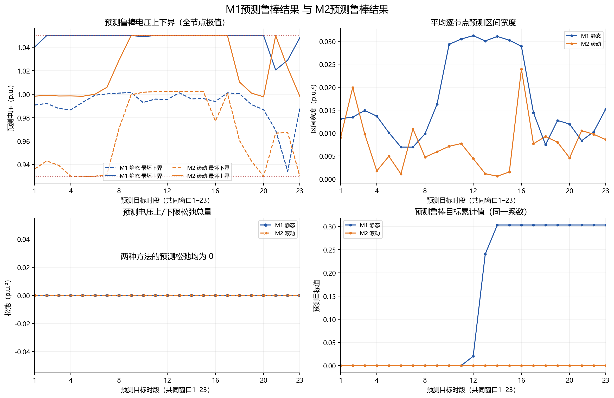
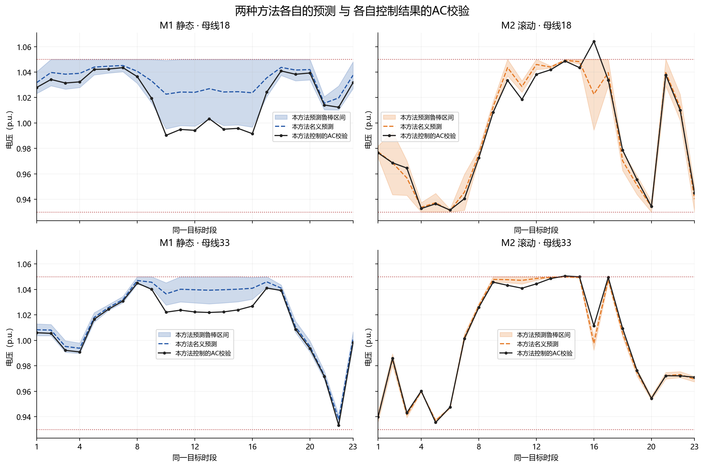
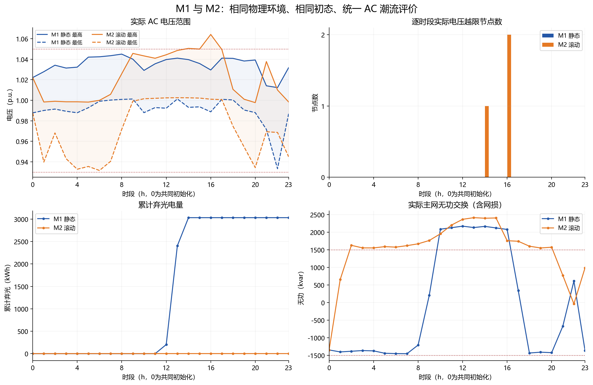
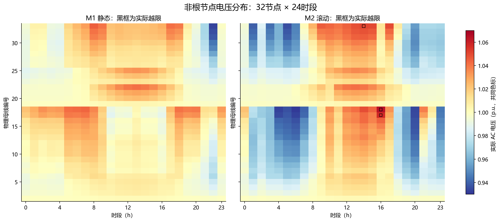

# M1静态优化与M2滚动优化：统一物理环境下的效果对比

两套算法均已完成24时段实际AC潮流评估，所有优化达到最优、所有AC潮流收敛。网络、真实线路阻抗、负荷与光伏序列、设备参数、约束数值、惩罚权重、初始状态和求解器设置均通过精确一致性检查。

## 本次三项要求的对应检查

1. **条件一致。** M1/M2均使用C_V=100、C_CURT=1，原M1实际目标向量的全部变量系数已逐列核验。其余物理参数和实际使用数组逐项比较。
2. **双边AC校验。** 每个时段分别将M1、M2控制结果写入相同环境的AC模型，共24对、48次runpf。M1的实际电压也是AC重新计算值，不使用其静态预测电压替代。
3. **双边预测对比。** 分别保存并比较两种优化器自己的名义电压、鲁棒上下界、松弛和目标，再与各自AC结果核对。

| 结果类别 | M1 | M2 |
|---|---|---|
| 优化器预测 | 1 + H_static·theta 的盒集逐节点极值 | 上一步AC电压平方 + H_delta·theta 的盒集逐节点极值 |
| 控制执行校验 | AC(theta*, 外部输入, M1控制) | AC(theta*, 外部输入, M2控制) |
| 下一步优化反馈 | 不反馈AC电压，执行已求好的静态计划 | 使用本方法上一步AC电压与已执行动作 |

M2使用AC量测作为起点，并不意味着其下一时段预测是“真实值”。两种方法的预测都使用LinDistFlow；只有各自控制执行后的AC潮流输出作为本仿真的真实校验值。

## 各设备初始状态

共同起点来自同一次M1完整求解的第0时段，逐项核对完整Dispatch：`u、pch、pdis、zch、zdis、gamma、energy_after`，并检查执行前E/SOC、执行后E/SOC、全部母线复电压完全相同。没有只比较SOC而遗漏无功或档位。

`initial_device_states.csv`逐设备列出M1值、M2值及差值（全部为0）；`initial_state_audit.json`保留完整原始状态和两边哈希。初始设备状态一致；后续状态由各自控制动作自然演化，不强制拉齐。

## 预测鲁棒结果对比（目标时段1–23）

M2在时段0没有独立预测，该行来自共同M1初始化，不能算作M2预测成果。下表在两边都使用相同的23个目标时段、32个非根节点。含共同初态的全日统计另存CSV。

| 预测指标 | M1预测 | M2预测 |
|---|---:|---:|
| 最坏下界最小值 / p.u. | 0.934122 | 0.930000 |
| 最坏上界最大值 / p.u. | 1.050000 | 1.050000 |
| 平均鲁棒区间宽度 / p.u.² | 0.01726540 | 0.00752066 |
| 最大鲁棒区间宽度 / p.u.² | 0.11001395 | 0.11350837 |
| 预测包络越过原电压限值的节点时段数 | 0 | 0 |
| 上限松弛总量 / p.u.² | 0.00000000 | 0.00000000 |
| 下限松弛总量 / p.u.² | 0.00000000 | 0.00000000 |
| 预测电压越限惩罚 | 0.00000000 | 0.00000000 |
| 预测弃光惩罚 | 0.30306583 | 0.00000000 |
| 预测鲁棒目标累计值 | 0.30306583 | 0.00000000 |
| 考虑松弛后的鲁棒约束最大残差 / p.u.² | 0.0000000000 | 0.0000000000 |

这里的预测最坏电压按相同盒集精确计算；每个节点的最坏参数可能不同，所有节点极值不一定由同一组参数同时达到。M1约束绝对电压，M2约束量测起点下的增量预测，所以即使外在参数相同，预测区间宽度和目标值也允许不同。

## 各自预测包络与各自AC校验的对应关系（时段1–23）

| 指标 | M1预测 vs AC(M1控制) | M2预测 vs AC(M2控制) |
|---|---:|---:|
| AC落在自身预测区间之外的节点时段数 | 476 | 519 |
| 自身预测区间对AC结果的覆盖率 / % | 35.326 | 29.484 |
| AC偏离自身预测区间的最大幅度 / p.u.² | 0.03369371 | 0.05261917 |
| 名义预测对AC结果的RMSE / p.u.² | 0.01941938 | 0.01064202 |

覆盖率是本次非线性AC结果落入线性鲁棒包络的经验比例，不是概率置信度，也不同于电压合格率。落出预测区间时实际电压仍可能合格；反之不能由预测可行推断AC必然合格。

`four_way_voltage_comparison.csv`在同一行并列给出同一时段、同一节点的M1预测上下界/名义值、AC(M1控制)、M2预测上下界/名义值、AC(M2控制)，便于逐点复核。

## 两套控制结果统一AC校验后的对比

以下评价基于实际非线性AC电压，包含共同的初始时段0。越限次数按“非根节点×时段”统计。

| 指标 | M1静态 | M2滚动 | M2−M1 |
|---|---:|---:|---:|
| 最低实际电压 / p.u. | 0.933288 | 0.931564 | -0.001725 |
| 最高实际电压 / p.u. | 1.045019 | 1.064196 | +0.019177 |
| 实际电压越限节点时段数 | 0 | 3 | +3 |
| 发生电压越限的时段数 | 0 | 2 | +2 |
| 节点时段电压合格率 / % | 100.000 | 99.609 | -0.391 |
| 最大上越限 / p.u. | 0.000000 | 0.014196 | +0.014196 |
| 最大下越限 / p.u. | 0.000000 | 0.000000 | +0.000000 |
| 越限幅度积分 / p.u.·节点·h | 0.000000 | 0.022257 | +0.022257 |
| 弃光电量 / kWh | 3030.658 | 0.000 | -3030.658 |
| 弃光率 / % | 3.6079 | 0.0000 | -3.6079 |
| 实际有功网损 / kWh | 7589.832 | 8386.863 | +797.031 |
| 主网无功最大越限 / kvar | 669.672 | 910.805 | +241.133 |
| 主网无功越限时段数 | 7 | 19 | +12 |
| 主网有功最大越限 / kW | 0.000 | 0.000 | +0.000 |
| 储能累计充电 / kWh | 3154.839 | 2979.681 | -175.158 |
| 储能累计放电 / kWh | 3417.242 | 3150.982 | -266.260 |
| 储能日末能量 / kWh | 400.000 | 513.874 | +113.874 |
| 实际电压平方越限惩罚 | 0.000000 | 4.699691 | +4.699691 |
| 实际弃光惩罚 | 0.303066 | 0.000000 | -0.303066 |
| 统一实际AC代价 | 0.303066 | 4.699691 | +4.396626 |

统一实际AC代价按原权重重新评价：

`J_AC = C_V × Σ[max(V_AC²−Vmax²,0)+max(Vmin²−V_AC²,0)] + C_CURT × ΣP_curt(p.u.)`。

这个指标使用共同的真实潮流结果；未将网损、无功越限或日末储能价值擅自加入原目标，因此须与表中其他物理指标一起解读。

## 结果解读

本场景中，M1实际电压越限为0个节点时段、弃光3030.658 kWh；M2为3个节点时段、弃光0.000 kWh。
两者统一实际AC代价分别为0.303066和4.699691。这些结果描述本次固定场景和确定求解设置下的轨迹，不证明某方法在一般情况下占优。

M1/M2日末储能分别为400.000/513.874 kWh。双方都沿用无日末SOC回归条件，故没有人为拉齐最终能量；净购电、网损与弃光指标需要结合此能量差一起阅读。

## 完全一致的外在设置如何保证

- 原M1源文件以及上一阶段M2的建模、数据、AC及验证模块均逐字节冻结，并在运行前后核对SHA256。原有两个文件夹不修改。
- 分别实例化M1/M2两套ModelData和ACPlant，逐项比较原参数、实际使用数组、真实阻抗、控制排序、求解设置；不是仅比较配置文件名。
- IEEE33的全部支路与节点负荷、24小时曲线、4处共10 MW光伏、2台SVG、4处电容器、节点18储能完全相同。
- 基值10 MVA/12.66 kV，DT=1 h，电压0.93..1.05，C_V=100、C_CURT=1，主网P/Q限值±20000 kW/±1500 kvar。
- 真实线路参数均采用原BRANCHES；固定不确定集合仅第5、12、16、29条线路r/x各自±30%，其他线路固定。没有在线更新或随机修改真实阻抗。
- 同一个M1完整最优解的第0时段动作复制给M2，两者初始能量、动作、AC电压及首时段后能量精确一致；M2不重复求解初始化。
- 同一PYPOWER牛顿AC求解及恒PQ注入语义，同一母线排序、符号和单位；均用独立复电流前推回代验证AC电压。
- 每个滚动时段再次检查整个场景哈希不变。求解Threads=1、Seed=0、MIPGap=1e-8、可行性与整数容差1e-8，两者相同。

共同场景SHA256：

`592cc9e76533681a91c88957159e652f9a2faba3553e1d0401252ae5cfd08550`

完整参数和逐项数组保存在`shared_scenario.json`，相等性与每时段校验结果保存在`fairness_audit.json`。

## 保留的模型结构差异

| 项目 | M1静态优化 | M2滚动优化 |
|---|---|---|
| 电压模型 | 从固定根电压计算绝对LinDistFlow电压 | 从上一步真实AC电压递推增量 |
| 求解时域 | 原代码一次联合求解24时段 | 23次单步求解，加共同的第0时段 |
| 储能决策可利用的时域 | 全24时段 | 当前状态与下一时段 |
| 控制执行 | 逐时段执行预先求好的计划 | AC执行成功后反馈并求下一步 |
| 参数/设备/初态/评价 | 完全相同 | 完全相同 |

原M1包含储能能量跨时段耦合，不能把它描述成24个互不关联的小时问题。本实验比较用户现有M1与文稿M2整体方法，并不隔离“只增加反馈”的因果效应；时域差异属于两种模型原有结构，已显式披露。

M1原有的P/Q±5、|Qpv|≤1、v0∈[-2,3]、Psi≤2和松弛≤1为宽松数值界。对当前物理设备功率范围做保守区间传播，证明其不限制M1物理可行控制；详细上界见审计文件。M2仍保留文稿要求的无上界非负电压松弛，不为对比改写原模型。

## 优化器目标与实际评价分开记录

M1全日优化目标：0.30306583；M2对应目标累计（含共同初始化时段诊断值）：0.00000000。
两者依赖不同的电压预测方式，不能仅根据目标值较小就判定实际运行更好。预测电压约束允许非零松弛，即使线性模型无松弛，非线性AC电压也可能越限。主网无损耗交换约束同样不严格保证含网损的实际交换限值。

为排除共同初始化时段的影响，`metrics.csv/summary.json`另列时段1..23的相同评价。

时段1..23：M1/M2名义预测电压平方RMSE分别为0.01941938/0.01064202 p.u.²；统一实际代价分别为0.303066/4.699691。

## 求解与数值验证

- M1完整求解耗时：0.165000 s。
- M2共23次滚动求解，合计0.215001 s，平均0.009348 s，最大0.019000 s。
- M2若单独运行还需初始化M1求解；计入该部分为0.380001 s。本次复用同一初始化解，未实际重复求解。
- 耗时为本机一次运行的求解器Runtime，不是稳定基准性能结论，也未把24时段一次求解时间与单步时间直接比较。
- M1原始约束矩阵、全部变量界与整数性检查通过；M1每时段和M2每步均验证精确盒集极值及全部256个顶点。
- M1/M2共48次AC潮流全部收敛；每次验证设备注入、节点功率平衡、总网损平衡与独立AC解。
- M2每次输入电压均与上一时段AC实测平方值精确一致；无参数更新、无重置储能或电容器。

多解说明：原目标没有动作平滑或额外择优项。当前固定求解器版本、线程和随机种子以便复现，不同求解器版本可能选出不同的同目标最优动作。本报告不挑选“最好看”的轨迹，也不隐含加入动作惩罚。

## 图表与数据

- `figures/`：8组PNG及SVG，含预测鲁棒结果、自身预测与AC校验、电压、光伏、储能、网损及无功控制。
- `robust_prediction_metrics.csv`、`robust_prediction_periods.csv`：预测鲁棒指标与逐时段数据。
- `four_way_voltage_comparison.csv`：同一时段同一节点的两套预测与两套AC值并列。
- `initial_device_states.csv`、`initial_state_audit.json`：完整初始设备状态。
- `paired_ac_audit.json`：24对AC校验的输入哈希、控制哈希和真实电压来源。
- `metrics.csv`：共同指标、全日及排除共同初态两种窗口、M2−M1绝对差。
- `period_comparison.csv`、`node_voltage_comparison.csv`、`device_comparison.csv`：逐时段/节点/设备明细。
- `m1_results.npz`、`m2_results.npz`：完整数值数组；M2附反馈输入和对偶变量，M1附原MILP解向量。
- `validation_details.json`：逐步数值验收残差与M2求解信息。

运行环境：Python 3.8.20，NumPy 1.24.4，SciPy 1.10.1，Gurobi 11.0.3，PYPOWER 5.1.19。
