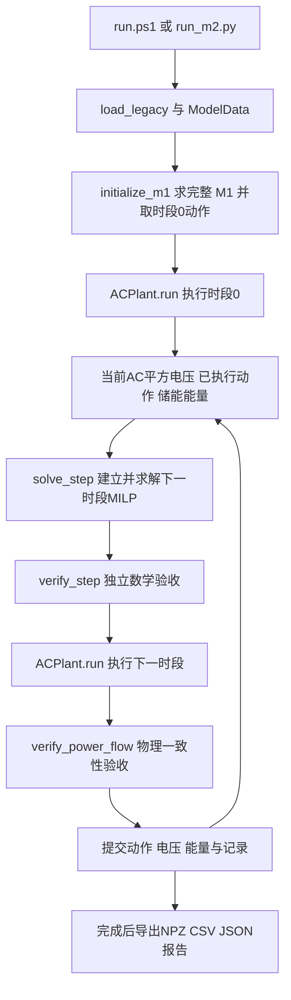

# m2_rolling 建模与滚动求解代码详解

本说明对应当前 `m2_rolling` 源码，重点解释建模方程如何进入 Gurobi，以及单步解如何经 AC 执行后进入下一次优化。它解释的是独立 M2 项目，不是后续 `m1_m2_comparison` 对比工程。

**最值得先读的两个函数是 `controller.py::solve_step()` 和 `run_m2.py::run()`。前者建立并求解一个下一时段问题；后者维护整条滚动轨迹。**

源码链接指向本次交付目录中与原项目逐字节相同的副本。行号按当前版本给出。

## 1 脚本角色和调用关系

| 脚本 | 角色 | 主要接口 | 是否参与优化决策 |
|---|---|---|---|
| [reference/rb_ieee33_storage.py](C:/Users/29909/Documents/Codex/2026-10-22/du-q/outputs/m2_rolling/reference/rb_ieee33_storage.py:38) | 原 M1 参数、网络、时序、变量与约束的冻结快照 | `Builder`、`b`、`extract_results(x)` | 初始化时使用完整 M1 模型 |
| [data.py](C:/Users/29909/Documents/Codex/2026-10-22/du-q/outputs/m2_rolling/data.py:14) | 把原数据组织成 M2 所需的矩阵与索引 | `load_legacy()`、`ModelData` | 提供常数，不求解 |
| [controller.py](C:/Users/29909/Documents/Codex/2026-10-22/du-q/outputs/m2_rolling/controller.py:103) | 初始化及单步鲁棒 MILP 建模求解 | `initialize_m1()`、`solve_step()` | 是，核心优化器 |
| [power_flow.py](C:/Users/29909/Documents/Codex/2026-10-22/du-q/outputs/m2_rolling/power_flow.py:31) | 将动作施加到真实参数的 AC 仿真环境 | `ACPlant.run()`、`PowerFlowResult` | 不优化，执行给定设定 |
| [validation.py](C:/Users/29909/Documents/Codex/2026-10-22/du-q/outputs/m2_rolling/validation.py:15) | 独立检查解的数学和物理一致性 | `verify_devices()`、`verify_step()`、`verify_power_flow()` | 验收，不修正动作 |
| [run_m2.py](C:/Users/29909/Documents/Codex/2026-10-22/du-q/outputs/m2_rolling/run_m2.py:165) | 组织初始化、滚动、状态提交、记录与导出 | `run()`、`main()` | 调用优化器，不直接写 MILP 约束 |
| [run.ps1](C:/Users/29909/Documents/Codex/2026-10-22/du-q/outputs/m2_rolling/run.ps1:1) | Windows 启动包装 | `-Python`、`-Steps`、`-Output`、`-SolverLog` | 否 |
| [tests/test_m2.py](C:/Users/29909/Documents/Codex/2026-10-22/du-q/outputs/m2_rolling/tests/test_m2.py:17) | 独立测试源数据、数学关系、极端状态和校验器 | 10 项 `unittest` 测试 | 测试时另行调用求解器 |
| [requirements.txt](C:/Users/29909/Documents/Codex/2026-10-22/du-q/outputs/m2_rolling/requirements.txt:1) | 经验证的依赖版本 | NumPy、SciPy、Gurobi、PYPOWER | 否 |



其中 `solve_step()` 不调用 AC 潮流，也不自行滚动；`ACPlant.run()` 不重新选择控制动作；历史状态由 `run()` 中的列表管理。

## 2 先掌握索引 单位和三种状态

### 2.1 时段和母线索引

- 全日有 24 个时段，代码编号为 `0..23`。
- M2 的循环参数 `t` 是已经执行的当前时段。一次调用优化的是 `t+1`，所以循环 `t=0..22`。
- 物理母线编号为 `1..33`，母线 1 是根节点。
- M2 电压、注入向量只含母线 `2..33`，物理母线 `bus` 对应位置 `bus-2`。
- AC 完整电压、原 M1 完整节点数组含根节点，物理母线 `bus` 对应位置 `bus-1`。
- 储能只有母线 18，因此 `pch[0]`、`energy_after[0]` 都对应这台储能，不能用 `bus-2` 索引储能数组。

### 2.2 单位

| 量 | 内部单位 | 工程单位转换 |
|---|---|---|
| 有功、无功、`u`、`pch/pdis` | p.u. | 乘 `power_base_kw=10000`，得到 kW/kvar |
| 储能能量 | p.u.·h | 乘 10000，得到 kWh |
| 优化器输入电压与预测电压 | 电压幅值平方 p.u.² | 取平方根才是幅值 |
| `voltage_pu` | 电压幅值 p.u. | 无需平方根 |
| 电容器 `gamma` | 档位整数 | 乘每档容量得到无功 |
| `zch/zdis` | 0/1 | 充放电模式许可状态 |

所以优化中的上下限是 `vlo=0.93²=0.8649`、`vhi=1.05²=1.1025`，不是直接用 0.93 和 1.05 与平方电压比较。

### 2.3 每次传入优化器的状态

滚动输入由三部分组成：

```python
measured = flows[-1].voltage_sq.copy()       # 当前时段的真实AC平方电压
actual = dispatches[-1].u.copy()            # 当前时段已经执行的控制
energy_before = energies[-1].copy()         # 下一时段动作执行前的能量
```

`u_actual` 用于计算动作变化量；`energy_before` 用于下一次充放电的可行性约束；`v_measured_sq` 是递推电压的起点。三者不能用上次预测结果随意替代。

## 3 data.py 如何把原始环境变成数学模型

### 3.1 原代码加载

`load_legacy()` 位于 [data.py:14](C:/Users/29909/Documents/Codex/2026-10-22/du-q/outputs/m2_rolling/data.py:14)，先检查原 M1 快照的 SHA256，再用 `importlib` 加载。

导入会执行原文件的模块级数据和约束构建，得到 `legacy.b` 等对象；不会执行受 `if __name__ == '__main__'` 保护的原 `main()`。因此“加载原代码”不等于已经求解 M1。

`ModelData(load_legacy())` 同时保存原模块和 M2 所需数据。网络、设备、负荷光伏与目标权重均从这里继承，不在控制器中重新手填一套。

`readonly()` 把主要数组设为只读，防止常规原地赋值。`uncertainty_digest()` 对 `F/g` 计算哈希；它检测固定不确定集合是否改变，并不是整个项目所有数据的总哈希。

### 3.2 外部注入与控制映射

在 [data.py:53](C:/Users/29909/Documents/Codex/2026-10-22/du-q/outputs/m2_rolling/data.py:53) 中：

```python
self.p_ex = readonly(self.p_available - self.p_load)
self.q_ex = readonly(-self.q_load)
```

采用“向网络注入为正”的符号。可用光伏已经在 `p_ex` 中，弃光通过控制映射减去；不能再次把光伏全额加入注入。

节点净注入统一写为：

\[
p_t=p_t^{ex}+B_pu_t,\qquad q_t=q_t^{ex}+B_qu_t.
\]

对应 `ModelData.injections(period, u)`，返回两个长度 32 的数组。

`u` 的当前列顺序为：

| Python 下标 | 设备控制 | 含义 |
|---|---|---|
| `0..3` | `curt` 母线18、22、25、33 | 弃光有功，`Bp` 系数 −1 |
| `4` | `pess` 母线18 | 储能净有功，放电为正、充电为负 |
| `5..8` | `qpv` 母线18、22、25、33 | 光伏无功 |
| `9..10` | `qsvg` 母线18、33 | SVG 无功 |
| `11..14` | `qcb` 母线6、12、24、30 | 电容器总无功，不是档位 |
| `15` | `qess` 母线18 | 储能无功 |

建议通过 `data.index['curt', 18]` 等键取位置，而非在修改代码时硬编码列号。`gamma` 单独保存电容档位，并用等式与 `u` 中的 `qcb` 关联。

### 3.3 路径矩阵 A

构建位置：[data.py:59](C:/Users/29909/Documents/Codex/2026-10-22/du-q/outputs/m2_rolling/data.py:59)。

`A` 的行是原支路顺序，列是非根母线。若支路 ℓ 位于根节点到母线 i 的路径上，则 `A[ℓ,i]=1`。

因而 `A @ p` 是各支路下游注入总和。若以根节点向末端为支路潮流正方向，无损耗支路有功为 `-A @ p`；这解释了注入符号与原支路潮流符号的关系。

对于固定 r/x，绝对 LinDistFlow 电压可写成：

\[
v=\mathbf 1+2A^T\operatorname{diag}(r)Ap
             +2A^T\operatorname{diag}(x)Aq.
\]

M2 使用这个表达式的时段差，并把绝对预测起点替换为实际 AC 量测。

### 3.4 固定参数盒集

构建位置：[data.py:81](C:/Users/29909/Documents/Codex/2026-10-22/du-q/outputs/m2_rolling/data.py:81)。

\[
\theta=[r_1,\ldots,r_{32},x_1,\ldots,x_{32}]^T\in\mathbb R^{64},
\]

\[
\underline\theta=\theta^{nom}-\rho,\qquad
\overline\theta=\theta^{nom}+\rho,\qquad
\mathcal U_0=\{\theta:F\theta\le g\},
\]

\[
F=\begin{bmatrix}I\\-I\end{bmatrix},\qquad
g=\begin{bmatrix}\overline\theta\\-\underline\theta\end{bmatrix}.
\]

全部 64 个分量都保留；只有 4 条线路的 r/x 共 8 个分量具有非零半径。其余分量是零宽度区间，不是从参数向量中删除了。

**θ 是不确定参数，不是 Gurobi 要寻找的控制决策。模型不选择一组“最好”的线路参数，而是要求对盒集内所有参数都满足所建电压约束。**

### 3.5 h0 和 K 是怎样来的

令 `Δu=u_next-u_actual`，则：

\[
\Delta p=\Delta p^{ex}+B_p\Delta u,\quad
\Delta q=\Delta q^{ex}+B_q\Delta u.
\]

定义 `ap=AΔp`、`aq=AΔq`，把递推电压对线路参数的系数写成：

\[
H=2\left[A^T\operatorname{diag}(ap)\quad A^T\operatorname{diag}(aq)\right].
\]

则 `v_next_pred = v_measured_sq + H @ theta`。

对每个节点 i，将参数系数向量展开为：

\[
h_i=h_i^{ex}+K_i\Delta u.
\]

`h_external(t)` 只计算外部负荷、光伏变化造成的 `H0`：

```python
ap = self.A @ (self.p_ex[t + 1] - self.p_ex[t])
aq = self.A @ (self.q_ex[t + 1] - self.q_ex[t])
return 2 * np.hstack([self.A.T * ap, self.A.T * aq])
```

这里 `A.T * ap` 是 NumPy 按列广播的逐元素乘法，相当于 `A.T @ diag(ap)`；不是矩阵乘法符号漏写。

`K` 在初始化时由 `A/Bp/Bq` 构建，它把动作变化映射成参数系数变化：

```python
h = h0[i] + data.K[i] @ (u - actual)
```

`h0[i]` 和 `actual` 是本次求解的已知常量，`u` 是决策变量，所以 `h` 是关于 `u` 的仿射表达式。求解之后的 `einsum('ijk,k->ij', K, Δu)` 是对所有节点执行同一个乘法。

### 3.6 维度总表

| 对象 | 维度 | 行列意义 |
|---|---|---|
| `A` | `(32,32)` | 支路 × 非根节点 |
| `Bp/Bq` | `(32,16)` | 非根节点 × 控制分量 |
| `u` | `(16,)` | 设备控制 |
| `p_ex/q_ex` | `(24,32)` | 时段 × 非根节点 |
| `theta_nom/radius` | `(64,)` | r 分量后接 x 分量 |
| `F` | `(128,64)` | 参数不等式 × 参数分量 |
| `g` | `(128,)` | 参数不等式右端 |
| `K` | `(32,64,16)` | 节点 × 参数分量 × 控制分量 |
| `h0/H` | `(32,64)` | 节点 × 参数分量 |
| `lambda_plus/minus` | 每种 `(32,128)` | 节点 × 参数不等式 |

## 4 controller.py 的接口和返回对象

### 4.1 Dispatch 是待执行的设备设定

[controller.py:12](C:/Users/29909/Documents/Codex/2026-10-22/du-q/outputs/m2_rolling/controller.py:12) 定义：

| 字段 | 本场景形状 | 含义 |
|---|---|---|
| `u` | `(16,)` | 弃光与各类设备净 P/Q 设定 |
| `pch/pdis` | 各 `(1,)` | 非负充电、放电功率 |
| `zch/zdis` | 各 `(1,)` | 二进制充放电许可 |
| `gamma` | `(4,)` | 电容器档位 |
| `energy_after` | `(1,)` | 本次动作执行后的储能边界能量 |

二进制变量的值为 1 只表示允许相应模式，其功率仍可能为 0。

`Dispatch` 在求解器返回时是待执行指令。只有 AC 与验收成功，主循环才把它放入 `dispatches`，视为已执行动作。

### 4.2 StepResult 是单步求解结果

[controller.py:23](C:/Users/29909/Documents/Codex/2026-10-22/du-q/outputs/m2_rolling/controller.py:23) 定义：

- `dispatch`：可送入 `ACPlant.run()` 的设备动作。
- `slack_plus/slack_minus`：各节点电压上、下限松弛，形状 `(32,)`。
- `h`：最优动作下的参数系数矩阵，形状 `(32,64)`。
- `v_nominal_sq`：名义参数下的递推预测平方电压。
- `v_lower_sq/v_upper_sq`：固定盒集上的精确逐节点最坏下、上界。
- `lambda_plus/lambda_minus`：对偶式的证书变量；绝对值式返回 `None`。
- `info`：目标、状态、Gap、求解及建模耗时、变量和约束数量、盒集哈希等。

这些预测电压都不属于真实 AC 结果，`StepResult` 本身也不含 AC 执行后的电压。

### 4.3 核心求解接口

```python
solve_step(
    data, t, v_measured_sq, u_actual, energy_before,
    formulation='dual', log=False, time_limit=120, failure_dir=None
) -> StepResult
```

| 输入 | 约定 |
|---|---|
| `data` | 已构建的 `ModelData`，全日外部时序和固定矩阵 |
| `t` | 当前已执行时段 `0..22`；本次目标时段是 `t+1` |
| `v_measured_sq` | 当前 AC 平方电压 `(32,)`，有限且为正 |
| `u_actual` | 当前已执行动作 `(16,)` |
| `energy_before` | 目标时段执行前能量 `(1,)`，即边界 `E[t+1]` |
| `formulation` | `'dual'` 正式对偶模型；`'absolute'` 独立等价验算 |
| `log` | 是否输出 Gurobi 日志 |
| `time_limit` | 每次优化时间上限；`None` 表示不在此设置上限 |
| `failure_dir` | 求解失败时保存 LP/IIS 的目录；并非所有输入错误都会写 LP |

函数检查维度、有限性、电压正值和输入能量界。它没有维护全日历史，因此调用者必须传入真实对应的当前状态；不能把任意同维数组当作有效反馈。

每次调用都会新建并关闭一个 Gurobi 模型，没有在这里复用上一时段模型或设置暖启动。当前项目直接依赖 `gurobipy`，没有给 M2 实现其他优化器回退路径。

## 5 solve_step 如何逐项建立 M2

### 5.1 决策变量

建模始于 [controller.py:120](C:/Users/29909/Documents/Codex/2026-10-22/du-q/outputs/m2_rolling/controller.py:120)。

```python
h0 = data.h_external(t)
with gp.Model('M2_%02d_%s' % (t + 1, formulation)) as model:
    _configure(model, log, time_limit)
    u = model.addMVar(data.nu, lb=-GRB.INFINITY, name='u_next')
    sp = model.addMVar(data.n, lb=0, name='s_plus')
    sm = model.addMVar(data.n, lb=0, name='s_minus')
```

`u` 的统一下界先设负无穷，因为无功和储能净有功允许负值。随后按设备添加边界，不能把它误解成设备没有约束。

除 `u/sp/sm` 外，还建立电容器整数档位、储能充放电功率与二进制模式、执行后能量，以及对偶证书变量。没有额外把 32 个下一步电压作为独立变量；电压约束通过 `v + hθ` 的鲁棒形式表达。

### 5.2 光伏约束

位置：[controller.py:127](C:/Users/29909/Documents/Codex/2026-10-22/du-q/outputs/m2_rolling/controller.py:127)。

\[
0\le P^{curt}_{i,t+1}\le P^{av}_{i,t+1},\qquad
|Q^{PV}_{i,t+1}|\le\kappa(P^{av}_{i,t+1}-P^{curt}_{i,t+1}).
\]

`available` 取 `t+1` 的可用光伏。实际光伏有功是“可用量减弃光”，而不是把 `curt` 当发电功率。无功能力沿用原功率因数关系，没有改成新的视在功率圆约束。

### 5.3 SVG 和电容器约束

SVG 在 [controller.py:134](C:/Users/29909/Documents/Codex/2026-10-22/du-q/outputs/m2_rolling/controller.py:134) 添加正负无功界。

电容器在第 138 行建立整数档位，并施加：

\[
\gamma_i\in\{0,1,2,3,4\},\qquad Q_i^{CB}=Q_i^{step}\gamma_i.
\]

这里电容器动作是离散决策，构成 MILP 的整数部分。模型没有相邻时段档位变化次数约束。

### 5.4 储能约束

位置：[controller.py:142](C:/Users/29909/Documents/Codex/2026-10-22/du-q/outputs/m2_rolling/controller.py:142)。

\[
0\le P^{ch}\le\overline P^{ch}z^{ch},\quad
0\le P^{dis}\le\overline P^{dis}z^{dis},\quad
z^{ch}+z^{dis}\le1.
\]

\[
P^{ESS}=P^{dis}-P^{ch},\qquad
-\overline Q^{ESS}\le Q^{ESS}\le\overline Q^{ESS}.
\]

对目标时段 `k=t+1`：

\[
E[k+1]=E[k]+\Delta t\left(\eta_{ch}P^{ch}[k]-P^{dis}[k]/\eta_{dis}\right).
\]

`energy_before` 对应 `E[k]`，决策变量 `eafter` 对应 `E[k+1]`。再按容量与 SOC 最小、最大值约束 `eafter`。

没有日末 SOC 回归条件、终端能量价值或 ESS 的新增 P/Q 圆约束。当前充放电二进制模式与电容器整数档位一起，使单步问题成为 MILP。

### 5.5 主网交换约束

位置：[controller.py:164](C:/Users/29909/Documents/Codex/2026-10-22/du-q/outputs/m2_rolling/controller.py:164)。

```python
pgrid = -data.p_ex[t + 1].sum() - data.Bp.sum(axis=0) @ u
qgrid = -data.q_ex[t + 1].sum() - data.Bq.sum(axis=0) @ u
```

分别等于非根节点净注入总和的相反数，然后施加原有主网 P/Q 范围。这里没有线路损耗项；实际 AC 主网交换由平衡节点计算，可能超出这个无损耗近似下满足的范围。潮流执行不是 OPF，不会自动修正动作来恢复主网范围。

### 5.6 鲁棒电压约束及对偶化

这是 M2 最关键的模型部分，见 [controller.py:171](C:/Users/29909/Documents/Codex/2026-10-22/du-q/outputs/m2_rolling/controller.py:171)。

对节点 i，要求所有 `θ∈U0` 都满足：

\[
\underline v-s_i^-\le v_i^{meas}+h_i^T\theta\le\overline v+s_i^+.
\]

上限等价于：

\[
\max_{F\theta\le g} h_i^T\theta
\le\overline v+s_i^+-v_i^{meas}.
\]

该线性最大化问题的对偶为：

\[
\min_{\lambda_i^+\ge0}\ g^T\lambda_i^+,
\quad F^T\lambda_i^+=h_i.
\]

因此在主优化问题中引入满足以下条件的证书变量即可：

\[
F^T\lambda_i^+=h_i,\quad
g^T\lambda_i^+\le\overline v+s_i^+-v_i^{meas},\quad
\lambda_i^+\ge0.
\]

下限对应最大化 `−h_i^Tθ`，得到：

\[
F^T\lambda_i^-=-h_i,\quad
g^T\lambda_i^-\le v_i^{meas}-\underline v+s_i^-,\quad
\lambda_i^-\ge0.
\]

代码原文为：

```python
d = 2 * data.n                         # 64 个线路参数分量
lp = model.addMVar((data.n, 2 * d), lb=0, name='lambda_plus')
lm = model.addMVar((data.n, 2 * d), lb=0, name='lambda_minus')
for i in range(data.n):
    h = h0[i] + data.K[i] @ (u - actual)
    model.addConstr(lp[i, :d] - lp[i, d:] == h, name='dual_upper_%d' % i)
    model.addConstr(lm[i, :d] - lm[i, d:] == -h, name='dual_lower_%d' % i)
    model.addConstr(data.g @ lp[i] <= data.vhi + sp[i] - v[i])
    model.addConstr(data.g @ lm[i] <= v[i] - data.vlo + sm[i])
```

为什么没有直接写 `F.T @ lambda`？因为 `F=[I;-I]`，该乘法就是前 64 项减后 64 项。每节点每侧 λ 长度 128，两侧各有 32 组。

为什么没有出现“控制 × 未知参数”的双线性优化？因为 θ 已被鲁棒对偶化消去；`h` 关于控制是仿射的，F 和 g 是常数，最终约束保持线性。

λ 的作用是证明某个控制在所建模型中鲁棒可行，不是估计真实 r/x，也不是设备价格。代码没有要求每个 λ 恰好取得支持函数的最小值，因此求解后的精确预测上下界另用盒集公式计算。

### 5.7 绝对值等价形式

[controller.py:183](C:/Users/29909/Documents/Codex/2026-10-22/du-q/outputs/m2_rolling/controller.py:183) 的 `'absolute'` 分支使用盒集支持函数：

\[
\max_{\theta\in\mathcal U_0}h_i^T\theta
=h_i^T\theta^{nom}+\rho^T|h_i|.
\]

通过非负辅助变量 `z≥h`、`z≥−h` 表示绝对值上界，施加名义预测加减 `radius @ z` 的约束。可行控制与原盒集鲁棒形式等价。

正式滚动执行采用对偶式的动作。绝对值式只在选定时段用相同输入再求一次，用于核对目标与可行性；其动作不送入实际 AC。由于多解，不能要求两种写法的最优动作逐项相等。

### 5.8 目标和最优结果提取

[controller.py:194](C:/Users/29909/Documents/Codex/2026-10-22/du-q/outputs/m2_rolling/controller.py:194)：

```python
curt_indices = [data.index['curt', bus] for bus in data.pv]
model.setObjective(data.cv * (sp.sum() + sm.sum()) + data.ccurt * u[curt_indices].sum())
model.optimize()
```

即：

\[
\min\;100\sum_i(s_i^++s_i^-)+\sum_{i\in PV}P_i^{curt}.
\]

目标只覆盖下一时段；弃光使用标幺功率，未在内部改成 kW 或电价成本。模型没有加入动作变化惩罚、网损成本或跨未来时段的目标。

仅接受 `GRB.OPTIMAL`；达到时间上限但有可行解也不按成功提交。若配置 `failure_dir`，非最优时写 LP，不可行时再尝试写 IIS；不把非最优状态一概解释成数学不可行。

最优后提取 NumPy 数值：

```python
result_u = u.X.copy()
h_value = h0 + np.einsum('ijk,k->ij', data.K, result_u - actual)
nominal_sq = v + h_value @ data.theta_nom
radius_sq = np.abs(h_value) @ data.radius
```

返回名义电压 `nominal_sq`、下界 `nominal_sq-radius_sq` 和上界 `nominal_sq+radius_sq`。这些结果用于记录和核验，下一步反馈仍必须来自 AC。

## 6 initialize_m1 为什么先求完整 M1

函数位于 [controller.py:50](C:/Users/29909/Documents/Codex/2026-10-22/du-q/outputs/m2_rolling/controller.py:50)。

接口为 `initialize_m1(data, log=False, time_limit=120) -> (Dispatch, info)`。

过程是读取 `legacy.b` 中的变量上下界、整数性、目标系数和全部约束行，组装稀疏矩阵，再用统一 Gurobi 设置求解原 24 时段模型。它没有直接调用原 `Builder.solve()`，因此初始化与 M2 可以使用同样的求解容差和线程设置。

随后只提取：

1. 第 0 时段的所有设备控制；
2. 第 0 时段的充放电功率与模式、电容档位；
3. 原 M1 的 `E[1]`，作为时段 0 执行后的能量。

原 M1 后续时段计划不参与 M2 滚动控制。虽然只取一个时段，但这个初始动作来自完整日计划的求解，而非只求第 0 小时。

原变量名称 `qsvc` 在适配时转成 M2 的 `qsvg`；原 `gam` 档位乘每档无功后，才填入控制向量的 `qcb`。

## 7 run_m2.py 如何驱动滚动过程

### 7.1 总入口接口

```python
run(output_dir, steps=23, log=False, time_limit=120, extra_checks=True) -> dict
```

返回 `summary` 字典，并在 `output_dir` 写数据与报告。`steps` 表示 M2 转换次数，范围为 1 到 23；`steps=1` 表示初始化时段 0 加一次对时段 1 的优化，不是只执行一个总时段。

### 7.2 初始化阶段

从 [run_m2.py:165](C:/Users/29909/Documents/Codex/2026-10-22/du-q/outputs/m2_rolling/run_m2.py:165) 开始：

```python
data = ModelData(load_legacy())
plant = ACPlant(data.legacy)
plant.check_box_membership(data)
digest = data.uncertainty_digest()
```

随后建立历史列表：

| 列表 | 内容 |
|---|---|
| `dispatches` | 已成功执行的设备动作，含第 0 时段 |
| `flows` | 与动作对应的已校验 AC 结果 |
| `energies` | 边界能量，第一个元素是 `E[0]` |
| `results` | M2 单步优化结果，不含 M1 初始化 |
| `voltage_inputs/control_inputs` | 每次 M2 真正读取的反馈，便于事后复核 |
| `records` | 每个执行时段的工程指标 |
| `checks/absolute_checks` | 数学验收及等价模型核验 |

时段 0 的执行顺序：

```python
action, m1_info = initialize_m1(data, log, time_limit)
checks.append(verify_devices(data, 0, action, energies[0]))
flow = plant.run(data, 0, action)
checks.append(verify_power_flow(data, plant, flow))
dispatches.append(action)
flows.append(flow)
energies.append(action.energy_after.copy())
```

至此才有真正可用于第一次 M2 的 `v0_measured`、`u0_actual` 和 `E[1]`。

### 7.3 主循环的精简执行链

下面保留了正式循环的核心顺序，省略的是等价式附加检查和日志，不是修改模型：

```python
for t in range(steps):
    measured = flows[-1].voltage_sq.copy()
    actual = dispatches[-1].u.copy()
    energy_before = energies[-1].copy()

    result = solve_step(data, t, measured, actual, energy_before,
                        'dual', log, time_limit, out / 'diagnostics')
    checks.append(verify_step(data, t, measured, actual, energy_before, result))

    next_flow = plant.run(data, t + 1, result.dispatch)
    checks.append(verify_power_flow(data, plant, next_flow))
    if data.uncertainty_digest() != digest:
        raise AssertionError('Fixed U0 was modified.')

    voltage_inputs.append(measured)
    control_inputs.append(actual)
    dispatches.append(result.dispatch)
    flows.append(next_flow)
    energies.append(result.dispatch.energy_after.copy())
    results.append(result)
```

源码位置：[读取与求解](C:/Users/29909/Documents/Codex/2026-10-22/du-q/outputs/m2_rolling/run_m2.py:191)、[AC 执行与状态提交](C:/Users/29909/Documents/Codex/2026-10-22/du-q/outputs/m2_rolling/run_m2.py:210)。

“滚动”来自循环中的三种最新状态及下一时段外部输入都变化；A/Bp/Bq/K、F/g、设备参数不随循环在线辨识或修正。每步求解窗口一直是一个时段。

### 7.4 储能时间线

| 阶段 | 优化/执行动作 | 执行前能量 | 执行后能量 | 产生的电压 |
|---|---|---|---|---|
| 初始化 | M1 时段0动作 `u[0]` | `E[0]` | `E[1]` | AC 时段0电压 |
| `t=0` | M2 时段1动作 `u[1]` | `E[1]` | `E[2]` | AC 时段1电压 |
| `t=1` | M2 时段2动作 `u[2]` | `E[2]` | `E[3]` | AC 时段2电压 |
| `t=22` | M2 时段23动作 `u[23]` | `E[23]` | `E[24]` | AC 时段23电压 |

当前已保存运行的前三个边界能量为约 `0.1、0.125918405、0.18 p.u.·h`，即 `1000、1259.184、1800 kWh`。所以第一次 M2 不能再把能量重置成 1000 kWh，也不能在传入前再重复执行一次时段 0 充放电。

储能能量由已选择的充放电功率及效率方程更新；AC 潮流只验证电网运行点，不另行积分一遍电池能量。

### 7.5 附加验算和求解次数

`extra_checks=True` 时，在循环 `t={0,9,12,18,22}`，也就是目标时段 `{1,10,13,19,23}`，对同样输入另外求一次绝对值等价式。

默认完整执行包括：1 次 M1 初始化、23 次正式 M2 对偶求解、5 次等价式附加求解，共 29 次优化调用；实际执行轨迹仍是 24 个时段，正式 PYPOWER 潮流为 24 次。每次 AC 另有独立前推回代验算，它不产生另一套控制轨迹。

`--skip-absolute-checks` 跳过这 5 次额外优化，不跳过每步 `verify_step()`、设备检查或 AC 一致性检查。

### 7.6 成功提交与失败处理

主循环在数学验收、AC 执行、AC 验收及集合哈希检查成功后，才追加动作、电压和能量。求解失败或潮流不收敛会抛异常，不用预测电压继续滚动。

主循环 `try` 覆盖范围内发生异常，会记录 `failure.json` 的阶段与错误信息；若已有成功轨迹，则保存已提交的数组。数据加载、`steps` 参数检查等发生在该 `try` 之前，不能假定所有启动错误都会产生此文件。

**实际电压越限不等于 AC 求解失败。** 若设备动作合法、鲁棒模型验收通过、潮流收敛且功率平衡正确，程序会如实记录电压或实际主网交换越限，并继续反馈该实际状态。这里没有自动安全修正动作或应急控制策略。

结束时还执行：

```python
feedback_error = np.max(abs(np.array(voltage_inputs) - all_voltages[:-1] ** 2))
if feedback_error != 0:
    raise AssertionError('Measured AC feedback is not used verbatim.')
```

这条断言专门确认滚动输入逐项等于前一时段 AC 电压平方。

## 8 power_flow.py 如何执行控制

### 8.1 接口与真实参数

`ACPlant(legacy)` 持有真实 r/x，当前取原数据的名义阻抗，不额外随机扰动。

```python
plant.run(data, period, dispatch) -> PowerFlowResult
```

这里 `period` 是当前要执行的绝对时段，不是 `solve_step` 的转换起点。`solve_step(..., t=5, ...)` 的结果要交给 `plant.run(..., period=6, ...)`。

### 8.2 注入重构与符号交叉检查

`_physical_injections()` 从负荷开始，逐设备加上光伏可用量减弃光、储能放电减充电和各设备无功。这一条计算路径不依赖 Bp/Bq。

随后用 `data.injections()` 再算一次并比较。目的是用两套独立映射发现设备母线或符号错误，而不是让同一个错误公式同时驱动控制器和仿真器。

电容器按 `gamma × 每档容量` 的恒 Q 执行；未将其替换成与电压平方相关的并联导纳模型。

### 8.3 AC 求解

PYPOWER 的 `PD/QD` 是消耗为正，因此代码使用 `-p*S_BASE`、`-q*S_BASE` 转成 MW/Mvar。根节点是唯一平衡节点，其余节点为 PQ 母线，优化后的光伏不被转换成自动调压的 PV 型母线。

`runpf` 执行 Newton AC 潮流，读取电压幅值和相角，再重建复电压。返回值包括：

| 字段 | 形状/单位 | 用途 |
|---|---|---|
| `v_complex` | `(33,)` 复数 p.u. | 独立 AC 解比较 |
| `voltage_pu` | `(33,)` p.u. | 电压幅值评价，含根节点 |
| `voltage_sq` | `(32,)` p.u.² | 下一步 M2 的反馈 |
| `p_injected/q_injected` | 各 `(32,)` p.u. | 检查实际设备注入 |
| `grid_p_pu/grid_q_pu` | 标量 p.u. | 实际主网交换 |
| `branch_*` | 各 `(32,)` p.u. | 实际支路两端潮流 |
| `loss_p_pu/loss_q_pu` | 标量 p.u. | 实际线路损耗 |
| `balance_residual_pu/mapping_residual_pu` | 标量 | 物理与映射残差 |
| `runtime_s` | 秒 | AC 求解耗时 |

决定反馈语义的返回片段在 [power_flow.py:121](C:/Users/29909/Documents/Codex/2026-10-22/du-q/outputs/m2_rolling/power_flow.py:121)：`vm[1:] ** 2`。这里已经去掉根节点并平方，主循环不能再平方一次。

## 9 validation.py 和 tests 的作用

### 9.1 四层验收

| 接口 | 输入 | 返回及失败行为 |
|---|---|---|
| `verify_devices(data, period, dispatch, energy_before)` | 某个实际目标时段及动作 | 检查设备边界、整数性、互斥、能量方程和无损耗主网约束；返回残差字典，超差抛错 |
| `verify_step(data, t, voltage_sq, actual, energy_before, result)` | 一次完整单步求解的输入与输出 | 重构 H，检查盒集极值、对偶、松弛、目标和设备；返回残差字典 |
| `verify_power_flow(data, plant, pf)` | AC 输出及真实参数环境 | 比较独立 AC 解、节点与全网功率平衡、映射误差 |
| `voltage_violations(data, voltage_pu)` | 非根节点电压幅值 | 返回实际越限数和幅度，不把运行越限当作求解器失败 |

`verify_step()` 不直接照抄优化器中的 h0+KΔu，而是分别构造当前、下一步注入，再用注入差计算 H。盒集最坏值按 h 每一项的正负选择上下端点，并用 256 个顶点交叉验证。

这里的顶点穷举用于核验线性参数函数的极值；不是正式优化采用的采样近似，也不构成 AC 最坏工况穷举。`box_vertices()` 限制非零半径分量不超过 16，以避免指数枚举失控。

`backward_forward_check()` 是另一种径向复电流 AC 算法，只验算 PYPOWER 的解。它与 `runpf()` 收敛并且相互一致，说明潮流计算得到可信的稳态运行点；不等于该运行点一定满足电压硬限值。

### 9.2 容差的具体层级

- Gurobi 可行性与整数容差为 `1e-8`，MIPGap 为 `1e-8`，MIPGapAbs 为 `1e-10`。
- PYPOWER 设置的潮流停止容差 `PF_TOL=1e-10`。
- `ACPlant.run()` 自己的节点功率残差报错阈值为 `1e-8`，映射阈值为 `1e-7`。
- `validation.py` 各类独立残差总体阈值为 `2e-7`，单位按被验变量区分。
- 实际电压越限计数容差为幅值 `1e-7 p.u.`。

不要把这些不同层级的容差混成一个“全程序精度”。

### 9.3 十项测试覆盖什么

`tests/test_m2.py` 包含：原快照未改动；物理数据与矩阵维度；路径矩阵 KCL；递推系数与绝对电压差一致；初始充放电只计一次；非零松弛与对偶/绝对值等价；AC 设备设定与功率平衡；SOC 上下边界；非法反馈拒绝；篡改松弛后验收器能否拒绝。

非零松弛测试人为给反馈增加 ±0.40 p.u.²，是独立数学压力测试，不是正式物理环境的时序输入。

## 10 输出文件和调试入口

### 10.1 主要输出

| 输出 | 内容 |
|---|---|
| `configuration.json` | 母线、控制排序、设备配置、矩阵维度及哈希 |
| `summary.json` | 全轨迹指标、求解次数、验收残差、初始化信息 |
| `period_summary.csv` | 逐时段实际电压、弃光、主网交换、预测误差与求解信息 |
| `device_dispatch.csv` | 逐设备工程单位动作、充放电与 SOC/能量 |
| `node_voltages.csv` | 各非根节点 AC 电压与 M2 预测包络；时段0预测列为空 |
| `rolling_arrays.npz` | 完整矩阵、状态、动作、预测与对偶变量 |
| `validation_details.json` | 各次验收及绝对值等价式检查明细 |
| `progress.json` | 已完成的滚动步骤 |
| `failure.json` | 主循环捕获的失败阶段与错误，成功后清理旧标记 |
| `diagnostics/failed_*.lp`、`.ilp` | 非最优模型及不可行时的 IIS 诊断 |
| `验证报告.md` | 自动生成的 M2 可行性与实际运行报告 |

### 10.2 全日 NPZ 索引对照

| 数组 | 默认完整运行形状 | 第一维 |
|---|---|---|
| `u` | `(24,16)` | 执行时段0..23 |
| `pch/pdis/zch/zdis/energy_after` | `(24,1)` | 执行时段0..23 |
| `gamma` | `(24,4)` | 执行时段0..23 |
| `voltage_pu` | `(24,33)` | AC 执行时段0..23 |
| `voltage_measured_sq` | `(24,32)` | AC 执行时段0..23 |
| `energy_boundaries_pu_h` | `(25,1)` | 边界0..24 |
| `voltage_input_sq` | `(23,32)` | 转换0→1至22→23 |
| `control_input_pu` | `(23,16)` | 转换0→1至22→23 |
| `h` | `(23,32,64)` | M2 目标时段1..23 |
| `v_nominal_sq/v_lower_sq/v_upper_sq/slack_*` | `(23,32)` | M2 目标时段1..23 |
| `lambda_plus/lambda_minus` | `(23,32,128)` | M2 目标时段1..23 |

例如，时段 16 的实际电压在 `voltage_measured_sq[16]`，其预测在 `v_nominal_sq[15]`。`voltage_input_sq[15]` 则是时段 15 的 AC 电压。

若仅运行少量 `steps`，轨迹数组长度会缩短；但原始 `p_ex_pu/p_load_pu` 等全日输入数组仍保留 24 时段，不能假定所有 NPZ 数组共享第一维长度。

### 10.3 不重新求解就能检查的反馈恒等式

在项目目录中读取已保存结果：

```python
import numpy as np

with np.load('results/rolling_arrays.npz', allow_pickle=False) as a:
    np.testing.assert_array_equal(a['voltage_input_sq'], a['voltage_measured_sq'][:-1])
    np.testing.assert_array_equal(a['control_input_pu'], a['u'][:-1])
    np.testing.assert_array_equal(a['energy_boundaries_pu_h'][1:], a['energy_after'])

    k = 16
    actual_voltage = a['voltage_measured_sq'][k]
    predicted_voltage = a['v_nominal_sq'][k - 1]
    prediction_error = actual_voltage - predicted_voltage
```

### 10.4 建议断点顺序

1. `data.py:97`：看 `h_external(t)` 是否取到了正确的相邻外部输入。
2. `controller.py:103`：看本次 t、量测、已执行动作和能量。
3. `controller.py:178`：看 `h0[i] + K[i] @ (u-actual)` 如何进入鲁棒模型。
4. `controller.py:195`：看目标中的权重和弃光列。
5. `controller.py:208`：看 `.X` 数值与预测包络提取。
6. `power_flow.py:69`：看每台设备如何进入实际注入。
7. `run_m2.py:210`：看下一时段 AC 输出。
8. `run_m2.py:216`：看验收成功后状态如何追加，下一轮读取什么。

最少阅读路线是：`run()` 的循环 → `solve_step()` 的输入与鲁棒约束 → `h_external/K` → `ACPlant.run()` → `verify_step()`。先把这条链读通，再看初始化和结果导出会更容易。

## 11 使用与修改时的边界

运行单步联调可以使用 `python run_m2.py --steps 1 --output results_single_step`，完整运行使用 `python run_m2.py --output results`。本机已有 `run.ps1` 可选解释器并传递参数；测试命令是 `python -m unittest discover -s tests -v`。

若后续改 M2 数学约束，重点在 `controller.py::solve_step()`；若改滚动窗口或状态更新，在 `run_m2.py::run()`；若改真实执行映射，在 `power_flow.py`；若改物理输入或矩阵定义，在 `data.py` 及数据来源处同步审查。原快照被哈希锁定，直接编辑它会触发源校验错误。

本说明只是对现有实现作代码讲解，没有添加新模型。当前逻辑没有参数学习、噪声滤波、预测误差修正、多步 M2 预测时域或失败后的安全控制回退。需要这些功能时，应作为明确的模型或工程扩展，而不能把现有函数的名称解释成已经具备这些能力。
