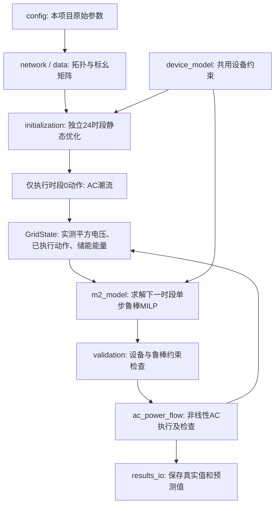

# 独立 M2 滚动鲁棒电压优化项目

本项目自行定义 IEEE 33 节点拓扑、负荷光伏曲线、设备参数、初始储能状态和不确定集合，自行建立初始化与滚动优化模型。运行时只需要本文件夹、Python 依赖和可用的 Gurobi 许可证。

原来的 `code`、`m2_rolling`、`m1_m2_comparison` 不属于本项目的运行依赖。本项目没有 `load_legacy()`、M1 继承类、旧模型的 `reference` 副本，也不读取其他项目的优化结果。文件夹可以单独复制、改名后运行。

采用以下闭环：**本地静态鲁棒初始化 → 执行时段0的AC潮流 → 单步M2优化 → 执行AC潮流 → 更新真实状态 → 下一次单步M2**。使用原有完整的24小时负荷与光伏数据，不额外添加预测误差或随机物理场景。

## 1. 先运行起来

已验证环境为 Python 3.8.20、NumPy 1.24.4、SciPy 1.10.1、gurobipy 11.0.3、PYPOWER 5.1.19。固定依赖适合 Python 3.8～3.11；不要直接用 Python 3.12 或更高版本安装这份锁定清单。Gurobi 需有能求解本模型规模的许可证。

在本项目目录打开 PowerShell，首次配置环境：

```powershell
python -m venv .venv
.\.venv\Scripts\python.exe -m pip install -r requirements.txt
```

完整运行24个时段，并对23次M2全部做等价模型交叉验证：

```powershell
.\.venv\Scripts\python.exe -X utf8 main.py --verify-all
```

先运行“初始化 + 1次滚动”便于阅读调试：

```powershell
.\.venv\Scripts\python.exe -X utf8 main.py --rolling-steps 1 --verify-all
```

也可在已经配置依赖的 Python 环境中直接执行 `python -X utf8 main.py`。不需要把旧 M1 项目加入 `PYTHONPATH`。

可选 PowerShell 入口：

```powershell
.\run.ps1 --verify-all
# 或指定已有的、已安装依赖的解释器：
$env:M2_PYTHON = 'C:\你的Python环境\Scripts\python.exe'
.\run.ps1 --rolling-steps 1
```

`run.ps1` 依次选择 `M2_PYTHON` 指定的解释器、本目录 `.venv`、系统 `python`，不查找旧项目解释器。不方便执行 `.ps1` 时，直接使用前面的 Python 命令即可。

| 命令选项 | 功能 |
|---|---|
| `--rolling-steps 23` | 0～23次滚动，默认23；加上初始化共24个已执行时段 |
| `--verify-all` | 每步额外求解绝对值等价模型；不指定时在时段1、6、12、18、23复算 |
| `--solver-log` | 显示 Gurobi 求解日志 |
| `--time-limit 120` | 每一个 MILP 的最长求解秒数，超时停止，不使用未证最优解继续控制 |
| `--output results/my_run` | 指定一个新的输出目录，已有内容时拒绝覆盖 |

默认输出位置为项目 `results/run_年月日_时分秒_微秒/`，不会覆盖随附的 `results/verified_run/`。

测试命令：

```powershell
.\.venv\Scripts\python.exe -X utf8 -m unittest discover -s tests -v
```

## 2. 每个脚本做什么

| 文件 | 核心职责 | 主要接口及输入输出 |
|---|---|---|
| `config.py` | 用工程单位显式定义拓扑、设备、负荷光伏、初始SOC、不确定支路和求解设置 | 常量配置；不执行模型求解 |
| `network.py` | 检查径向拓扑，生成上下游关系、根路径和路径矩阵A | `build_network(branches, bus_count, root_bus) → Network` |
| `data.py` | 从本地配置构造标幺数组、设备映射Bp/Bq、F/g和控制系数K | `SystemData()`；`injections(period, control)`；`external_change_matrix(period)` |
| `states.py` | 把跨脚本接口写成具名数据容器 | `Dispatch`、`GridState`、`StepResult`、`PowerFlowResult` |
| `device_model.py` | 添加光伏、SVG、电容器、储能及无损主网功率约束，初始化和M2共用 | `add_devices(model, data, period, energy_before) → DeviceVariables`；`extract_dispatch(...) → Dispatch` |
| `initialization.py` | 用本项目代码建立并求解完整24时段静态鲁棒MILP，生成初始动作 | `solve_initial_schedule(data, ...) → InitialSchedule`；其中只有`actions[0]`被实际执行 |
| **`m2_model.py`** | **构建并求解真实电压反馈下的单步M2，包含文档对偶鲁棒化和等价验证形式** | **`solve_step(data, state, formulation='dual', ...) → StepResult`** |
| **`main.py`** | **组织初始化、逐时段优化、设备检查、AC执行和真实状态更新** | **`run_simulation(output_dir, rolling_steps=23, ...) → summary`**；也是命令行入口 |
| `ac_power_flow.py` | 按设备实际设定构造独立AC网络，调用PYPOWER；提供第二种潮流算法复核 | `run_ac(data, period, action) → PowerFlowResult`；`backward_forward_sweep(data, p, q)` |
| `validation.py` | 从求解后的数值独立检查设备约束、SOC、256顶点鲁棒约束、对偶证书、AC功率平衡 | `validate_initial_schedule`、`validate_step`、`validate_ac`；失败直接抛出异常 |
| `solver_utils.py` | 统一设置求解精度、种子、线程、时限；失败时保存模型诊断 | `configure_solver`、`optimize_checked` |
| `results_io.py` | 保存JSON、CSV、NPZ和本次中文验证说明 | `save_results(directory, data, schedule, records, fingerprint, run_options)` |
| `tests/test_model.py` | 13项回归测试，含非零目标压力测试和真实反馈时序核验 | `python -m unittest discover -s tests -v` |
| `run.ps1` | 可选的Windows启动入口 | 参数原样传给`main.py` |
| `requirements.txt` | 固定本次验证的依赖版本 | `python -m pip install -r requirements.txt` |

**建议阅读顺序：**先看 `config.py` 知道设备和场景，再看 `main.py` 的整体流程；重点逐行阅读 `m2_model.py` 和 `device_model.py`。遇到矩阵来源时查 `data.py`、`network.py`，遇到状态字段时查 `states.py`，最后看 `ac_power_flow.py` 和 `validation.py`。



## 3. 自己定义的数据，以及与M1相同的内容

| 参数 | 本项目设置 |
|---|---|
| 网络 | IEEE33，33母线、32支路，母线1为根节点；每条线路r/x在`BRANCHES`中逐行定义 |
| 基准 | 10 MVA、12.66 kV，阻抗基准16.02756 Ω |
| 时间 | 24时段，每时段1小时 |
| 电压 | 根节点1 p.u.，运行区间0.93～1.05 p.u.，优化使用平方界限0.8649～1.1025 |
| 目标系数 | 电压松弛100，弃光1；不添加动作、储能、平滑或损耗惩罚 |
| 光伏 | 母线18/22/25/33：3000/2000/2000/3000 kW；最低功率因数0.95 |
| SVG | 母线18、33，各±600 kvar |
| 电容器 | 母线6、12、24、30，每档150 kvar，0～4档整数 |
| 储能 | 仅母线18；充/放各1000 kW，容量2000 kWh，无功±600 kvar；充放效率均0.95 |
| 储能SOC | 最小0.2、最大0.9、初始0.5，即初始1000 kWh |
| 主网限值 | 有功±20000 kW，无功±1500 kvar；优化口径为无损功率 |
| 不确定集合 | 支路5、12、16、29的r/x各自独立±30%；其余线路固定，共8个变化维度、256个顶点 |
| AC真实阻抗 | 本地`TRUE_RESISTANCE_OHM`和`TRUE_REACTANCE_OHM`，当前等于表中标称值 |
| 负荷/光伏 | `LOADS`、`LOAD_PROFILE`、`PV_PROFILE`显式定义；与M1逐项一致 |

`verification/parameter_audit.json` 保存一次性**项目外验收**的证据：51组参数/派生数据精确一致；包括原始线路、设备、初始SOC、24×32负荷光伏数组、标幺阻抗、路径、目标权重和不确定集合。不是运行时读取M1来构建数据。

此外，将本项目独立静态初始化的完整解转换为原M1的变量，逐项代入原M1全部5401行约束、5449个变量边界和整数约束检查；最大残差约`3.6e-15`。重新求解原M1的目标为`0.3030658284469051`，独立初始化目标为`0.3030658284469552`，差约`5.0e-14`。

**初始参数一致不意味着求解出的动作逐元素相同。** 原M1固定的是初始储能能量E0；SVG、CB、光伏无功等首时段动作本身是优化变量，并无额外固定“初始档位”。本项目按同一静态模型独立计算首时段动作。目标没有动作惩罚，很多动作组合具有相同最优值；变量排列、建模方式或求解器版本改变后，可以得到另一个最优动作，进而得到不同的M2闭环轨迹。这里没有硬编码旧最优动作来强行复制旧轨迹。

若后续做严格的M1/M2闭环对比，需要让两个控制器共享**同一组已求出的初始化动作及其AC状态**，并把两个控制序列送入同一AC环境。本项目当前提供独立M2实现和验证，不包含新的效果对比脚本。

## 4. 先弄清单位、编号和接口

所有配置用工程单位写在 `config.py`：kW、kvar、kWh、Ω。优化器统一使用p.u.，功率基准为10000 kW。能量除以10000后为p.u.·h；例如1000 kWh对应0.1 p.u.·h。

母线编号是**1～33**；支路表的第1行是**支路1**。NumPy数组下标从0开始。非根节点向量只包含母线2～33，`data.node_index[18]`返回母线18对应的向量下标16。时段从0～23。

| 对象 | 维度/单位 | 意义 |
|---|---|---|
| `data.A` | 32×32 | 行为支路，列为非根节点；支路在节点根路径上则为1 |
| `data.Bp`, `data.Bq` | 32×16 | 把设备控制映射成节点有功/无功净注入 |
| `data.K` | 32×64×16 | `K[i]`把动作变化映射成节点i的线路参数系数变化 |
| `theta_nominal`, `theta_radius` | 64 | 前32个r，后32个x；固定参数的半径为0 |
| `F`, `g` | 128×64、128 | 固定盒式集合`F @ theta <= g` |
| `Dispatch.control` | 16，p.u. | 弃光4、储能有功1、PV无功4、SVG无功2、CB无功4、储能无功1 |
| `Dispatch.energy_after` | 1，p.u.·h | 当前动作执行后的储能能量 |
| `GridState.period` | 整数 | 最近已经完成AC执行的时段 |
| `GridState.measured_voltage_sq` | 32，p.u.² | 最近执行时段的真实AC平方电压 |
| `GridState.actual_control` | 16，p.u. | 最近已执行动作 |
| `GridState.energy` | 1，p.u.·h | 下一个待求解时段执行前的能量 |
| `StepResult.predicted_*_sq` | 32，p.u.² | 名义预测、鲁棒下界、鲁棒上界，不是AC真实幅值 |
| `PowerFlowResult.voltage_pu` | 33，p.u. | AC真实电压幅值，包含根节点 |
| `PowerFlowResult.voltage_sq` | 32，p.u.² | AC真实非根节点平方电压，下一步直接使用 |

净注入以发电为正：弃光减小注入，储能放电增大注入，负荷为负。储能净有功为`放电 - 充电`。充放电辅助变量不再重复加入控制向量。

## 5. M2的建模过程：对应 `m2_model.py`

`solve_step(data, state, ...)`输入当前真实状态，只优化下一时段；它不执行潮流、不改变`state`。

**第一步：确定当前与目标时段。** `state.period=t`，目标时段为`t+1`。`check_state`检查维度、有限值、正平方电压和储能能量范围；输入值是否已平方仍由接口调用者负责，程序不能只凭数值可靠区分幅值与平方值。

**第二步：添加设备变量和约束。** `add_devices`建立下一时段的控制向量、充放电功率、互斥0/1状态、储能执行后能量、CB整数档位。PV约束为：

```text
0 <= P_curt <= P_available
|Q_PV| <= tan(arccos(0.95)) * (P_available - P_curt)
E_after = E_before + eta_ch * P_ch * dt - P_dis * dt / eta_dis
z_ch + z_dis <= 1
Q_CB = 每档无功 * 整数档位
```

此外添加SVG、储能无功、SOC边界及无损主网P/Q限值。没有PV/ESS视在容量圆、储能日末SOC回归、支路容量、动作次数或爬坡约束。

**第三步：建立增量电压系数。** `data.external_change_matrix(t)`计算负荷光伏变化产生的`H0`；`K`已由固定拓扑和设备接入关系提前计算。

```text
delta_u = u_next - u_actual
delta_p = p_external[t+1] - p_external[t] + Bp @ delta_u
delta_q = q_external[t+1] - q_external[t] + Bq @ delta_u
H = 2 * A.T @ [diag(A @ delta_p), diag(A @ delta_q)]
h_i = H0[i] + K[i] @ delta_u
v_next(theta) = v_measured_sq + H @ theta
```

代码中的`h`是节点i对应的64维系数向量。线路参数是鲁棒不确定量，不能由控制器挑一个有利值当作实际参数。

**第四步：把“对所有线路参数成立”转换成线性对偶约束。** 对每个节点引入两组非负128维对偶变量：

```text
F.T @ lambda_upper = h_i
g @ lambda_upper <= Vmax² + slack_upper[i] - v_measured_sq[i]
F.T @ lambda_lower = -h_i
g @ lambda_lower <= v_measured_sq[i] - Vmin² + slack_lower[i]
lambda_upper >= 0, lambda_lower >= 0
```

因为`F=[I;-I]`，代码把`F.T @ lambda`写成`lambda[:64] - lambda[64:]`，避免建立大量零系数，数学含义完全相同。上下电压松弛均非负、无上界。

`formulation='absolute'`使用盒式集合的等价支持函数：

```text
predicted_nominal = measured + h_i @ theta_nominal
radius = abs(h_i) @ theta_radius
worst_lower = predicted_nominal - radius
worst_upper = predicted_nominal + radius
```

建模时用线性辅助变量表示`abs(h_i)`。它用于交叉检查默认对偶式的最优目标；复算所得动作不送入实际AC执行。

**第五步：设置目标并求解。**

```text
min 100 * sum(slack_upper + slack_lower) + 1 * sum(P_curt)
```

目标使用p.u.弃光和p.u.²电压松弛，不擅自改成kW、不增加时长乘数、二次项或动作惩罚。求解后从实际动作重新计算精确盒式上下界，返回`StepResult`。

## 6. 滚动过程：对应 `main.py`

初始静态计划不是滚动器的未来控制输入。`initialization.py`保留原静态模型的24时段能量耦合、设备约束和数值变量界限，独立重建无损支路潮流和静态鲁棒电压方程。只有计划第0个动作用于产生真实起点，其他23个动作仅存档供核验。

储能时序需要特别注意：

```text
E0 = 1000 kWh
执行初始化动作u0：E0 -> E1，AC得到v0_measured
第一次M2：输入 v0_measured、u0、E1；求解u1和E2
执行u1的AC：得到v1_measured；提交状态(period=1, voltage=v1_measured, energy=E2)
第二次M2：输入 v1_measured、u1、E2；求解u2和E3
……
执行u23后得到E24
```

循环中依次执行：`solve_step → validate_step → run_ac → validate_ac → GridState更新`。只有全部成功后才提交状态；失败则抛出异常，停止后续滚动。下一步使用的是`ac_result.voltage_sq`，绝不会把`predicted_nominal_sq`作为真实反馈。

整个过程中，`F/g`、线路参数、`K`、负荷光伏和设备参数保持不变；每步检查参数指纹。反馈只更新电压、已执行动作和储能能量，不用于学习线路参数、修正预测误差或缩小不确定集合。

## 7. AC真实执行如何保证口径一致

`physical_injections`按设备含义逐项重构注入：PV用“可用光伏减弃光”，储能用“放电减充电”，SVG/PV/储能无功按求解值，电容器用“档位乘每档kvar”。再与`Bp/Bq`的注入映射比较，避免相同错误在两个模块中被掩盖。

AC网络使用同一拓扑、相同标幺基准及本地真实r/x，调用PYPOWER牛顿法潮流。控制动作不裁剪、不修改、不加额外平衡设备。电容器是与原设备定义一致的恒Q注入；PV作为给定PQ注入，而不是偷偷改成电压控制PV节点。

AC求解后再用复电压、欧姆定律检查节点功率平衡；用独立前推回代算法复核整组复电压，并检查“主网输入 + 各节点净注入 = 网络损耗”。

**主网无功的一个必要区别：**优化器保留原M1的无损功率平衡。AC潮流包含线路损耗，根节点实际无功可能超过1500 kvar。代码报告这一结果，不通过改变主网限值或强行裁剪控制来掩盖。根节点按固定电压的平衡节点运行，PYPOWER在此求潮流而不是求带硬限值的AC最优潮流。

## 8. 验证内容与本次结果

随附 `results/verified_run/` 是完整24时段、23次M2、23次等价模型复算的结果。每步都进行了256个盒式顶点核验，而不是仅查看求解器状态。

| 验证内容 | 本次结果 |
|---|---|
| 独立物理参数对照 | 51组精确一致，差值为0 |
| 独立初始化代入原M1全部约束 | 通过，最大残差约3.6e-15 |
| 23次正式M2求解 | 均达到设定最优性精度 |
| 对偶与绝对值形式最优目标 | 23步均一致；测试另含正电压惩罚的人工压力输入 |
| 设备、SOC、整数、256顶点、对偶等式不等式 | 均通过数值复核 |
| AC求解与独立潮流复核 | 24时段全部收敛；复电压最大差约5.8e-11 p.u. |
| 独立性 | 仅复制12个运行脚本到隔离目录，禁止读取原整个工程目录后，初始化和2次滚动仍通过 |
| 回归测试 | 13项全部通过；记录在`verification/tests.txt` |
| 实际AC电压范围 | 0.930100～1.058371 p.u. |
| 实际欠压/过压 | 0 / 4个节点时段，计数容差1e-7 p.u. |
| 实际弃光 | 0 kWh |
| 含损耗主网实际无功超限 | 18个时段，最大约2309.643 kvar |

**结论是：模型数值可解，约束实现通过核验，完整闭环可以执行；不是所有实际AC运行指标都满足硬限值。** 当前优化有电压软约束，LinDistFlow也存在近似误差，因此预测鲁棒区间不能保证包住真实AC电压。预测鲁棒性、实际电压合格率和完整交流运行可行性必须分开评价。

本测试只覆盖给定24小时、固定真实线路参数的场景，不能据此宣称已证明所有不确定真实网络下的闭环安全性，也不能只用本项目结果判断M2一定优于M1。

`verification/isolation_check.json`记录隔离运行的源码哈希及参数指纹；`verification/验收记录.md`集中说明参数、独立性和完整闭环的验收依据。开发过程中保留的`results/preliminary_run/`是初步运行存档；正式验收以`verified_run/`为准，发布压缩包不含初步存档。

## 9. 输出文件怎么读

| 文件 | 内容 |
|---|---|
| `summary.json` | 完成情况、电压越限、弃光、损耗、主网实际限值、验证残差最大值 |
| `验证说明.md` | 当前运行自动生成的中文说明 |
| `parameters.json` | 原始配置、实际使用的标幺数组、拓扑和参数快照 |
| `manifest.json` | Python/库版本、运行参数、各主脚本SHA256 |
| `solver_and_checks.json` | 初始化及逐时段求解状态、Gap、时间和验证结果 |
| `periods.csv` | 每时段目标、AC电压极值、弃光、主网功率、损耗和求解时间 |
| `controls.csv` | 每个设备实际设定及执行后能量，单位kW/kvar/kWh |
| `voltages.csv` | 每个非根节点的真实AC幅值、预测平方电压区间和松弛 |
| `trajectory.npz` | 完整数值轨迹，包含反馈输入、对偶变量、能量、节点注入和支路AC功率 |
| `initial_static_plan.npz` | 完整初始化计划，只有第0行进入真实执行 |
| `failure_diagnostics/` | 失败时保存的LP；确定不可行时另保存IIS文件 |
| `failure.json` | 命令行运行失败时记录错误，不伪造成功摘要 |

注意：`summary.json`中的`initialization_full_horizon_objective`是完整静态计划的24时段总目标，`rolling_objective_sum`是时段1～23的M2目标和；两者不能直接作为公平效果比较。`periods.csv`时段0的`objective`只记该时段的目标贡献，但`solver_seconds`是生成初始化计划的完整求解耗时。

读取NPZ示例：

```python
import numpy as np

with np.load('results/verified_run/trajectory.npz', allow_pickle=False) as result:
    print(result.files)                     # 所有数组名称
    print(result['voltage_pu'].shape)        # (24, 33)，AC电压幅值
    print(result['control'].shape)           # (24, 16)，设备控制，p.u.
    print(result['energy_after'] * 10000)    # 每次执行后kWh
    print(result['feedback_voltage_sq'][0]) # 第一次M2使用的时段0真实反馈
```

## 10. 后续修改从哪里入手

修改负荷、光伏、设备位置/参数或不确定支路时编辑`config.py`，再重新运行；`data.py`会重新建立对应矩阵。设备位置仍须是已定义的非根节点，支路必须朝向下游且构成连通径向网络。

学习模型时，建议在`m2_model.py`的`h`构造、四条对偶约束以及`main.py`的`GridState`更新处设断点。Gurobi变量的`.X`只能在成功求解后读取；求解前它只是待优化符号。

修改目标、反馈策略或增加物理约束后，应更新验证标准和报告。随附的参数一致性审计及结果只对应`manifest.json`记录的代码与默认配置；改动后不再自动代表与原M1相同。
